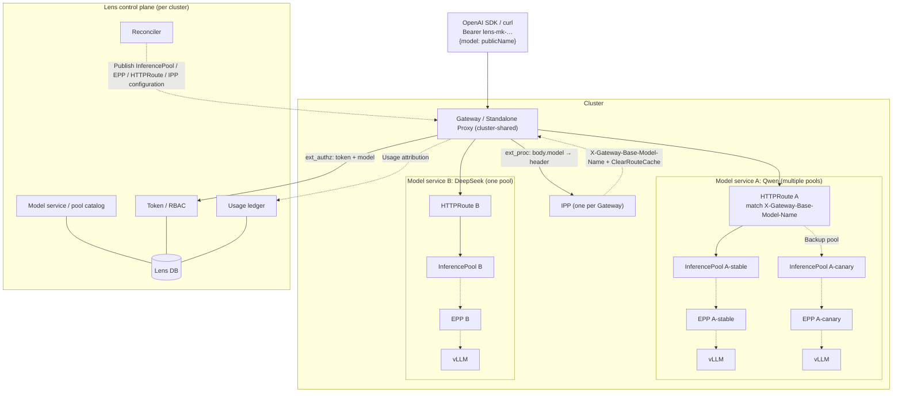
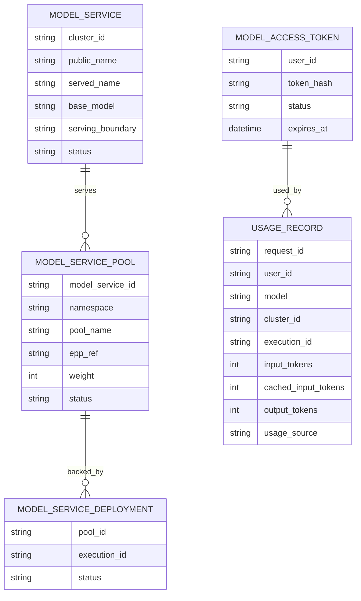

# Model Service Design

Model services use per-cluster native llm-d Gateway Mode: one shared cluster Gateway and IPP, deployment-owned InferencePool/EPP, and model-service-owned HTTPRoute publication. Lens owns catalog, authorization, tokens, reconciliation and usage attribution, not cross-cluster inference routing.

This is the single canonical design for this module. Section numbers retain their
original part-local context; use the links below for unambiguous navigation.

| Part | Scope and status |
| --- | --- |
| [Native llm-d routing](#lens-model-service-design-per-cluster-native-llm-d) | Current per-cluster routing and control-plane ownership. |
| [Gateway deployment and operations](#model-service-gateway-deployment-and-operations-guide-llm-d-gateway-mode) | Deployment layers, configuration, acceptance and troubleshooting. |

<!-- design-part: gateway-mode -->

## Lens Model Service Design (Per Cluster, Native llm-d)

Each cluster exposes its own OpenAI-compatible endpoint. The community llm-d data plane (Gateway/Proxy + IPP + InferencePool + EPP) serves every model service in that cluster. Lens supplies only control-plane capabilities absent from the community stack.

### 1. Goals and scope

- Configure services per cluster; users call the cluster endpoint by model name.
- Multiple models and LoRA within one cluster.
- User tokens, model-service authorization, and cluster-specific visible models.
- Usage ledger by user/model/cluster and four token categories.

Out of scope: cross-cluster routing, custom Lens proxies/schedulers, quotas/billing, and rate limits. Community HTTPRoute owns weighted multi-pool splitting; Lens only renders configuration.

### 2. Design principles

- Reuse community capabilities; implement only missing capabilities in Lens.
- Lens does not carry inference bytes or select endpoints/replicas.
- Publish standard llm-d / GAIE / Gateway API resources only.
- Keep cluster boundaries: one model service routes to **one** pool/EPP. llm-d-router watches a single named InferencePool per EPP, and its gateway chart puts one pool in each HTTPRoute. Lens therefore does not weight across pools; with multiple members, use the highest-priority active member.

### 3. Capability ownership

| Capability | Owner |
| --- | --- |
| Gateway/Proxy, TLS, HA | Community + provider |
| Multi-model/LoRA payload routing | Community IPP |
| Pool endpoint set | Community InferencePool |
| Load/KV/prefix endpoint scheduling | Community EPP |
| Model-name rewriting | Community InferenceModelRewrite |
| Charts/CRDs | Community `llm-d-router-*`, `payload-processor` |
| Usage/metrics | Community Envoy/EPP/vLLM metrics |
| Model catalog/publication | Lens |
| Token issuance/validation | Lens |
| Model-service authorization/visibility | Lens |
| Usage ledger | Lens |
| Publication reconciliation/audit/lifecycle | Lens |
| UI/documentation | Lens |

### 4. Overall architecture



One shared Gateway per cluster; each deployment provides its own `InferencePool` + EPP without a proxy. Each model service gets one HTTPRoute referencing **one** InferencePool. Solid arrows show routing/data; dashed arrows show ext_proc/control interactions.

### 5. Cluster preparation and versions

Data-plane components have three layers:

- **Shared cluster (at cluster creation):** Gateway API / GAIE CRDs, provider, **Gateway**, IPP.
- **Deployment:** model server + EPP + InferencePool, 1:1, no Gateway/proxy.
- **Model service (at publication):** HTTPRoute and IPP model mapping, referencing the cluster Gateway and deployment pool.

Pin versions alongside llm-d/llm-d-benchmark in the cluster wizard Software versions step:

| Component | Version field | Source |
| --- | --- | --- |
| llm-d (local Lens use) | `llm_d_ref` | Source checkout |
| llm-d-benchmark (local use) | `llm_d_lensmark_ref` | Source checkout |
| Gateway provider | `gateway_provider` + `gateway_version` | Helm chart / CRD |
| GAIE / Gateway API CRDs | `gie_version` | Official manifests |
| llm-d Router (EPP / Proxy) | `router_version` | Helm chart / image |
| IPP | `ipp_version` | Helm chart / image |

- IPP/Router/provider are cluster components installed as charts/images, not local source caches.
- Select and validate pinned compatible version sets across IPP ↔ Router ↔ GIE ↔ provider ↔ Kubernetes.

#### 5.1 Gateway and Deployment semantics

- **Start the shared Gateway at cluster creation:** install Gateway API/GAIE CRDs, provider, Gateway, and IPP (§5), one Gateway per cluster.
- **Deployments do not start their own Gateway/proxy:** use the shared Gateway.
- **Deployments retain their EPP + InferencePool:** create together, EPP:pool 1:1, chart proxy disabled. Pool selectors select pods; scaling changes only pod counts.
- **Model services generate HTTPRoute:** `parentRefs` targets the cluster Gateway; `backendRefs` targets one pool for the highest-priority active member, with IPP model mapping.

Deployment order: create pool/EPP and wait for readiness, then publish the model service HTTPRoute.

### 6. Domain model



- `public_name`: model name requested by users.
- `served_name`: model name accepted by the downstream engine.
- `base_model`: IPP model-mapping pool key for LoRA; equals served_name without LoRA.
- `serving_boundary`: `gateway` (Gateway API) or `standalone` (Proxy sidecar).
- `MODEL_SERVICE_POOL`: a service routes to one InferencePool+EPP at a time, choosing the highest-priority active member; no cross-pool weighting.
- `MODEL_SERVICE_DEPLOYMENT`: deployment backing a pool, for display and usage attribution.

The diagram describes logical resources. The implemented persistence model uses
`model_service_groups` and `model_service_members`, not separate pool/deployment
tables:

| Table | Current contract |
| --- | --- |
| `model_service_groups` | Public model name, cluster, served/base model, display metadata and status. |
| `model_service_members` | Group-to-execution association, cluster/target service, pool/EPP references, ownership and health. |
| `model_access_tokens` | User-owned token hash/hint, status, expiry, revocation and last-use metadata; never plaintext. |
| `usage_records` | Request/user/model/cluster/execution attribution and token counts; not a billing ledger. |

The ORM definitions under
[`apps/backend/src/llm_d_lens/db/models/`](../../apps/backend/src/llm_d_lens/db/models)
own exact columns and constraints. Services use the matching DAOs; schema edits
follow the [database design](database-design.md).

### 7. Request flow

```mermaid
sequenceDiagram
    participant C as Client
    participant GW as Gateway / Standalone Proxy
    participant IPP as IPP
    participant AUTH as Lens ext_authz
    participant EPP as EPP
    participant V as vLLM
    C->>GW: POST /v1/chat/completions (Bearer lens-mk-…)
    GW->>IPP: ext_proc
    IPP-->>GW: X-Gateway-Model-Name / Base-Model-Name + ClearRouteCache
    GW->>AUTH: ext_authz (token + model headers)
    AUTH->>AUTH: token→user; model→service in this cluster; check access
    alt Invalid token / denied
        AUTH-->>GW: 401 / 404
    else Allowed
        AUTH-->>GW: Identity headers
        GW->>GW: HTTPRoute by Base-Model-Name → InferencePool
        GW->>EPP: ext_proc
        EPP-->>GW: x-gateway-destination-endpoint
        GW->>V: Forward; return SSE
        GW--)AUTH: Usage attribution
    end
```

### 8. Authorization

Standard Envoy **ext_authz** points to Lens; no custom ext_proc or subset.

- Input: Authorization and IPP-injected X-Gateway-Model-Name.
- Processing: validate token → resolve public_name within the cluster → check access.
- Output: identity headers (hashed x-lens-user-id); no destination.
- Rejection: 401/404, without distinguishing missing resources from forbidden ones.

Authorization is at **model-service level**; EPP owns endpoint selection.

### 9. Control-plane components

| Module | Responsibility |
| --- | --- |
| Catalog | Per-cluster service/pool CRUD; associate deployments with pools at publication; derive served_name/serving_boundary |
| Tokens | Issue/revoke/reset; plaintext shown once |
| Authz | Model-service authorization; identical visibility and invocation rules |
| Reconciler | Render/apply community resources, wait for readiness, audit |
| Usage | Collect community usage, attribute by execution, persist idempotently |
| Visibility API | Per-cluster `/v1/models` returns only public_name values visible to this token in that cluster |

`ModelTokenService` reuses the auth domain's random-token and SHA-256 primitives
but keeps model tokens in a separate namespace/table from login sessions.
Tokens use the `lens-mk-` prefix; creation/reset returns plaintext once, while
persistence retains the hash and a last-four-character hint.
Validation rejects inactive or expired tokens. Resetting a selected token revokes
that token; resetting without an ID revokes all active tokens for the user before
creating a new one. Last-use metadata is touched at most once per 60 seconds.
The current management APIs and UI are documented in the
[Model services API manual](../site/i18n/en/docusaurus-plugin-content-docs/current/api-reference/modules/model-services.mdx)
and [user guide](../site/i18n/en/docusaurus-plugin-content-docs/current/user-guide/model-services.mdx).

### 10. Published resources

Each deployment provides its own InferencePool + EPP (§5.1). Model publication creates one HTTPRoute (`parentRefs` → cluster Gateway; `backendRefs` → highest-priority active pool) and IPP model mapping. llm-d has one EPP per pool; Lens does not weight across pools:

```yaml
# Provided by deployment (one set per deployment)
apiVersion: inference.networking.k8s.io/v1
kind: InferencePool
metadata: { name: qwen, namespace: inference }
spec:
  selector: { matchLabels: { llm-d.ai/model: qwen, llm-d.ai/pool: stable } }
  targetPorts: [{ number: 8000 }]
  endpointPickerRef: { name: qwen-epp, port: { number: 9002 }, failureMode: FailClose }
---
apiVersion: inference.networking.k8s.io/v1
kind: InferencePool
metadata: { name: qwen-new, namespace: inference }
spec:
  selector: { matchLabels: { llm-d.ai/model: qwen, llm-d.ai/pool: canary } }
  targetPorts: [{ number: 8000 }]
  endpointPickerRef: { name: qwen-new-epp, port: { number: 9002 }, failureMode: FailClose }
---
# Published by model service
apiVersion: gateway.networking.k8s.io/v1
kind: HTTPRoute
metadata: { name: qwen, namespace: inference }
spec:
  parentRefs: [{ name: llm-d-inference-gateway }]
  rules:
    - matches:
        - headers:
            - { type: Exact, name: X-Gateway-Base-Model-Name, value: "Qwen/Qwen3-32B" }
      backendRefs:
        - { group: inference.networking.k8s.io, kind: InferencePool, name: qwen }
```

```yaml
apiVersion: v1
kind: ConfigMap
metadata: { name: qwen-model-map, namespace: inference, labels: { inference.llm-d.ai/ipp-managed: "true" } }
data:
  baseModel: "Qwen/Qwen3-32B"
  adapters: |
    - food-review-1
---
apiVersion: llm-d.ai/v1alpha1
kind: PayloadProcessorConfig
metadata: { name: ipp, namespace: inference }
spec:
  plugins:
    - { type: body-field-to-header, parameters: { fieldName: model, headerName: X-Gateway-Model-Name } }
    - { type: base-model-to-header }
  profiles:
    - name: default
      plugins: { request: [{ pluginRef: body-field-to-header }, { pluginRef: base-model-to-header }] }
```

One Gateway serves multiple models. Each model has one HTTPRoute referencing **one** InferencePool + EPP.

Layering: Gateway owns cross-pool weights, but llm-d uses one EPP per pool and its official gateway chart places one pool per HTTPRoute, so Lens renders no multi-pool weights. Within a pool, EPP performs inference-aware `Filter→Score→Pick` scheduling for KV/queue/prefix. Lens renders pool/model mapping, not scheduling logic.

### 11. My services page

- Group services by cluster, displaying public_name, status, and invocation examples.
- Show each cluster's own base URL/examples; call that cluster's endpoint.
- User-level tokens work across clusters; visible models are filtered by user + cluster.

### 12. Health and lifecycle

Publication flow:

```
Select cluster + deployment (already supplies InferencePool + EPP)
 -> Derive serving contract (served_name)
 -> Render/apply HTTPRoute + IPP configuration
 -> Wait for Gateway / HTTPRoute / InferencePool readiness
 -> Probe the model
 -> Mark Ready
```

| Dimension | Evidence |
| --- | --- |
| Configuration ready | Gateway/HTTPRoute conditions, endpointPickerRef, selector |
| Transport reachable | Gateway listener, DNS, certificate, readiness |
| Pool available | EPP candidates and ready model server |
| Correct model | Served-name/adapter probe |

Disable/delete/update handle desired/observed revisions and draining. Deleting one model does not uninstall shared Gateway/IPP.

### 13. Usage

- Collection: reuse Envoy/engine/EPP usage and metrics.
- Attribution: record the final selected execution; use the known granularity when uncertain.
- Idempotency: deduplicate by request_id; without engine usage mark `usage_source=estimated`.

Persist input, cached-input, cache-write and output token counts separately.
Keep request count, status, streaming flag, timing and evidence source alongside
the attribution. Quotas, balances, prices and rate limits are outside this design.

### 14. Error contract

| Condition | Response |
| --- | --- |
| Invalid/revoked token | 401 |
| Missing/forbidden model | 404 |
| No healthy destination | 503 |
| Body too large | 413 |

Do not replay generative requests unconditionally. Once SSE output starts, failure terminates that stream.

### 15. Implementation boundaries

The operations part below owns supported provider setup and known gaps.
Acceptance criteria describe the required contract; they do not imply that
unimplemented provider TLS, HA or draining paths are already available.

### 16. Acceptance

| Case | Expected |
| --- | --- |
| Multiple models + LoRA in one cluster | Public name → IPP → base model → correct pool; body.model retains adapter |
| Multiple members for one model | One HTTPRoute references one pool: highest-priority active member; no cross-pool weighting |
| Long prompt | Correct body bounds; IPP supplies model header |
| Cluster visibility | Each cluster's `/v1/models` returns only models visible to the token there |
| Provider wiring | HTTPRoute → InferencePool → EPP |
| Metric association | Each pool uses its own EPP load |
| Publication lifecycle | Traceable desired/observed revisions; no false Ready; deletion retains shared Gateway/IPP |
| Usage | Execution attribution; correct SSE/cancel/failure sources; no duplicate accounting |
| HA | Consistent authorization/visibility across control-plane instances |

<!-- /design-part: gateway-mode -->

<!-- design-part: gateway-operations -->

## Model Service Gateway Deployment and Operations Guide (llm-d Gateway Mode)

> Design: [`model-service-design.md`](model-service-design.md#lens-model-service-design-per-cluster-native-llm-d).
> This is the Gateway Mode deployment checklist/runbook. The community llm-d data plane
> consists of the shared cluster Gateway, IPP, InferencePool and EPP.
> The control plane and renderers are implemented;
> actual data-plane installation and acceptance require a real cluster.

### 1. Data-plane layers

The three Gateway Mode layers have separate lifecycles:

| Layer | Created when | Resources | Code |
| --- | --- | --- | --- |
| Shared cluster | Cluster creation/update | Gateway API / GAIE CRDs, provider, **Gateway**, **IPP** | `llm_d_lens/model_service/gateway_providers.py` (`render_inference_gateway`), `gateway_ops.py` (`install_inference_gateway` / `install_ipp`) |
| Deployment | Deployment creation | Model server + EPP + **InferencePool** (1:1, **no own proxy/gateway**) | `llm_d_lens/deploy/...` (disable chart proxy; see `router-gateway-mode.values.yaml`) |
| Model service | Publication | **HTTPRoute**, cross-namespace **ReferenceGrant**, IPP model-mapping **ConfigMap** | `gateway_providers.py` (`render_model_route`), `gateway_ops.py` (`reconcile_cluster_gateway`) |

```
Client ──► Shared cluster Gateway ──► HTTPRoute (base-model match)
                                          │ backendRefs: InferencePool
                                          ▼
                                  InferencePool ──► EPP ──► model server (vLLM)
                    ▲
        IPP (ext_proc: body.model → X-Gateway-Base-Model-Name + ClearRouteCache)
```

One Gateway per cluster; **one HTTPRoute per model service**, whose `backendRefs` points to
**one** InferencePool. llm-d uses one EPP per pool; Lens does not split traffic by weights
across pools.

### 2. Cluster prerequisites

- Lens backend/database are running, and the target cluster is registered with kubeconfig in Lens DB.
- Kubernetes 1.32+ with Gateway API and Gateway API Inference Extension
  (GAIE, `InferencePool` `inference.networking.k8s.io/v1`) CRDs.
- Install the selected **Gateway provider**, configured through `gatewayProvider` during
  cluster creation (§4.1): `gke`, `istio`, `agentgateway`, or `envoy-ai-gateway` (default).
- **Envoy AI Gateway requires InferencePool backend support.** Otherwise HTTPRoute references
  are `InvalidKind` (`ResolvedRefs=False`) and requests receive 500 direct responses.
  Include the inference-pool addon when installing Envoy Gateway:

  ```bash
  helm upgrade -i eg oci://docker.io/envoyproxy/gateway-helm \
    --version v1.8.1 -n envoy-gateway-system --create-namespace \
    -f https://raw.githubusercontent.com/envoyproxy/ai-gateway/v0.7.0/manifests/envoy-gateway-values.yaml \
    -f https://raw.githubusercontent.com/envoyproxy/ai-gateway/v0.7.0/examples/inference-pool/envoy-gateway-values-addon.yaml
  ```

  The addon sets `extensionApis.enableBackend: true`, `extensionManager.hooks`, and:

  ```yaml
  extensionManager:
    backendResources:
    - group: inference.networking.k8s.io
      kind: InferencePool
      version: v1
  ```

  > If automation repeatedly runs `helm upgrade eg`, include these values there.
  > Manual edits to `envoy-gateway-system/envoy-gateway-config` are overwritten on upgrade.

- **The cluster must allocate a LoadBalancer address.** With empty `status.addresses`, Gateway
  stays `Programmed=False` (`reason=AddressNotAssigned`). Cloud providers allocate addresses;
  local kind requires `cloud-provider-kind` or MetalLB.
  If installing a load balancer is impossible, set **`LENS_GATEWAY_SERVICE_TYPE=NodePort`**
  and reconcile. Lens uses provider-supported Service overrides: `EnvoyProxy` for Envoy AI
  Gateway; a `ConfigMap` referenced by `Gateway.spec.infrastructure.parametersRef` for Istio
  (matching llm-d's `guides/recipes/gateway/istio`).
- **Istio:** install with
  `istioctl install -y --set values.pilot.env.ENABLE_GATEWAY_API_INFERENCE_EXTENSION=true`
  (the llm-d guide pins 1.29.4). Lens renders `istio.io/enable-inference-extproc: "true"` on
  the Gateway; the recipe requires it for EPP inference ext_proc.

### 3. Environment variables

| Variable | Default | Description |
| --- | --- | --- |
| `LENS_IPP_CHART` | `oci://ghcr.io/llm-d/charts/payload-processor` | IPP Helm chart path or OCI reference |
| `LENS_IPP_VERSION` | `v0.1.0` | IPP chart version; also configurable through cluster `ipp_version` |
| `LENS_MODEL_RECONCILE_INTERVAL_SECONDS` | `300` | Background shared-Gateway/model-route reconciliation interval, seconds |
| `LENS_MODEL_HEALTH_INTERVAL_SECONDS` | `10` | Member backend health-probe interval, seconds; each round reprobes HTTPRoute/InferencePool/EPP/model server. Do not set zero, which causes busy polling |
| `LENS_MODEL_GATEWAY_PUBLIC_URL` | Empty | Gateway entry URL displayed to users |
| `LENS_GATEWAY_SERVICE_TYPE` | Empty | `LoadBalancer`/`NodePort`/`ClusterIP` using official provider overrides (`EnvoyProxy` for Envoy, ConfigMap parametersRef for Istio). Use NodePort without LB; empty retains provider default |

### 4. Deployment steps

#### 4.1 Create cluster and install the shared Gateway

New cluster fields (migration `c1f7a2b9d4e6`):

| Field | Description |
| --- | --- |
| `gateway_provider` | `gke` / `istio` / `agentgateway` / `envoy-ai-gateway` |
| `gateway_namespace` / `gateway_name` | Default `lens-gateway` / `lens-inference-gateway` |
| `router_version` / `gie_version` / `ipp_version` | Pinned versions |

- **Wizard:** choose provider and optional IPP version in **Model gateway**. After saving,
  the backend calls `install_inference_gateway` in the background.
- **API:** `POST /api/v1/model-service/admin/gateway/install` with `cluster_id` and optional
  `provider`, or PATCH cluster `gatewayProvider`. `cluster/router.py` schedules installation
  after create/PATCH.
- Render Namespace, GatewayClass, and Gateway (HTTP `:80`). Envoy AI Gateway additionally
  renders ClientTrafficPolicy with a default `50Mi` connection buffer.

#### 4.2 Publish model services and members

- Create a model group/public model name through `POST /api/v1/model-service/admin/groups`.
  Groups carry `cluster_id`, `served_name`, and `base_model`; `(cluster_id, name)` is unique.
- Publish a deployment as a member through `POST /api/v1/model-service/admin/members`.
  Select cluster/deployment; execution supplies `namespace / service / port / endpointKind`.
- `pool_name` defaults from EPP Service: `<release>-epp` → `<release>` (`default_pool_name`),
  qualified as `<namespace>/<release>` (`qualified_pool_name`) to prevent namespace collisions.
  HTTPRoute rendering splits it back into name/namespace. `epp_ref` records the EPP reference.
- **EPP must serve plaintext.** Gateway Mode values in `router-gateway-mode.values.yaml`
  disable the chart proxy and set `router.epp.flags.secure-serving=false`. Otherwise default
  TLS ext_proc (`secure-serving=true`) resets shared-Gateway plaintext h2c calls, causing 500s.
- Multiple members may be published, but routing uses the **highest-priority active member's**
  pool; others are backups. Reconciliation creates cross-namespace ReferenceGrants as needed.
- **Deleting deployments cascades to members:** health probing (default 60s) removes dangling
  members when their execution records no longer exist. If a model service has no members,
  reconciliation removes its leftover HTTPRoute and model-map ConfigMap.

#### 4.3 Install IPP

IPP (`lens-ipp`, Deployment) runs in the Gateway namespace and injects model headers via ext_proc:

```python
from llm_d_lens.model_service.gateway_ops import GatewayOpsService

await GatewayOpsService().install_ipp("cluster-a")  # Default chart/version/name
await GatewayOpsService().uninstall_ipp("cluster-a")
```

Version precedence: request → `LENS_IPP_VERSION` → cluster `ipp_version` → default.

#### 4.4 Reconciliation and resources

`reconcile_cluster_gateway` ensures Gateway exists, then renders/applies resources for
**each model service with an active member**:

```python
from llm_d_lens.model_service.gateway_ops import GatewayOpsService

await GatewayOpsService().reconcile_cluster("cluster-a")
```

- **HTTPRoute:** one per model service in Gateway namespace, named with a DNS-safe model slug.
  `parentRefs` points to the cluster Gateway; matches use IPP-injected
  `X-Gateway-Base-Model-Name = base_model`. `backendRefs` contains **one**
  `{group: inference.networking.k8s.io, kind: InferencePool, name: <pool_name>, [namespace]}`
  for the highest-priority active member. **Do not set `port`:** InferencePool `spec.targetPorts`
  owns it, matching the official llm-d-router-gateway chart.
- **ReferenceGrant:** when namespaces differ, create one in each pool namespace permitting
  Gateway-namespace HTTPRoutes to reference that InferencePool.
- **ConfigMap:** `<slug>-model-map` in Gateway namespace, label
  `inference.llm-d.ai/ipp-managed=true`, containing `data.baseModel` and `adapters`.

`llm_d_lens/api/main.py` reconciles all clusters with non-disabled members every
`LENS_MODEL_RECONCILE_INTERVAL_SECONDS`. Apply is idempotent and safe to repeat.

#### 4.5 Administration UI and APIs

The **Data plane** panel at `?view=admin/model-service` shows an actionable topology:
one Gateway per cluster, IPP, and each pool/EPP/model server. Operations use
`POST /api/v1/model-service/admin/gateway/stream` (SSE logs) or matching REST endpoints:

| Operation | Endpoint | Permission |
| --- | --- | --- |
| Status | `GET …/gateway/status` | `model-service:gateway:read` |
| Install Gateway | `POST …/gateway/install` | `model-service:gateway:manage` |
| Reconcile | `POST …/gateway/reconcile` | `model-service:gateway:manage` |
| Scale components | `POST …/gateway/scale` | `model-service:gateway:manage` |
| Install/uninstall IPP | `POST …/gateway/stream` (`op=install-ipp`/`uninstall-ipp`) | `model-service:gateway:manage` |
| Install/uninstall/reconcile Gateway | `POST …/gateway/stream` (`op=install-gateway`/`uninstall-gateway`/`reconcile`) | `model-service:gateway:manage` |
| Probe | `POST …/gateway/probe` | `model-service:gateway:manage` |
| Preflight | `POST …/gateway/preflight` | `model-service:router:manage` |

Gateway uninstall cleans resources labeled `app.kubernetes.io/part-of=lens-inference-gateway`
and legacy `lens-agent-router` resources (`…=lens-agent-router`). All operations are audited
in `model_service_gateway_operations`.

### 5. Acceptance

```bash
# Gateway ready (requires an address)
kubectl get gateway lens-inference-gateway -n lens-gateway
# NAME                     CLASS              ADDRESS       PROGRAMMED
# lens-inference-gateway   envoy-ai-gateway   10.x.x.x      True

# Route references resolved
kubectl get httproute -n lens-gateway -o yaml | grep -A3 ResolvedRefs   # ResolvedRefs=True

# Direct local verification without an LB address
kubectl port-forward -n envoy-gateway-system \
  svc/$(kubectl get svc -n envoy-gateway-system \
        -l gateway.envoyproxy.io/owning-gateway-name=lens-inference-gateway \
        -o jsonpath='{.items[0].metadata.name}') 8899:80
curl -s localhost:8899/v1/completions -H 'Content-Type: application/json' \
  -H 'X-Gateway-Base-Model-Name: Qwen/Qwen3-0.6B' \
  -d '{"model":"Qwen/Qwen3-0.6B","prompt":"hi"}'
```

### 6. Troubleshooting

| Symptom | Cause/check |
| --- | --- |
| `Programmed=False` (`AddressNotAssigned`) | No LB address; inspect `EXTERNAL-IP` with `kubectl get svc -n envoy-gateway-system`; install cloud-provider-kind/MetalLB for kind |
| HTTPRoute `ResolvedRefs=False` (`InvalidKind`) | Missing InferencePool addon (§2); verify `extensionManager.backendResources` includes `inference.networking.k8s.io/v1 InferencePool` |
| `Invalid resource name "…/…"` | Model ID contains `/`; resource names require DNS normalization (`resource_name` handles it; reconcile old names) |
| Multiple members but no route | Confirm derived `pool_name`, `status=active`; reconcile and inspect `kubectl get httproute -A`: one route, one backendRef for the highest-priority active member |
| Route exists but requests return 500 | `ResolvedRefs` must be True; InvalidKind generates a 500 direct response |
| All requests reach one replica | Check pool selector against model-server pod labels; Lens does not weight across pools |

### 7. Security

- Backends expose ClusterIP only; the shared Gateway is the external entry point.
- Plaintext tokens are returned once at creation; logs contain only `token_hint`.
- Kubeconfig resides in Lens DB. Rendering/reconciliation is server-side and does not accept
  arbitrary client-supplied destination addresses.

### 8. Known gaps

- **Data-plane metering is integrated:** periodically read per-cluster Prometheus EPP counters
  `llm_d_epp_request_{input,output,cached}_tokens_sum`, native llm-d metrics. Attribute deltas by
  `fairness_id` into `usage_records` (`POST …/admin/gateway/usage/sync`, background
  `LENS_GATEWAY_USAGE_INTERVAL_SECONDS`). `default-flow` without injected identity aggregates by model.
- **HTTP-provider ext_authz injection is rendered:** with `LENS_MODEL_GATEWAY_AUTHZ_HOST`,
  `render_inference_gateway` creates in-cluster lens-authz Service/Endpoints pointing to Lens.
  Envoy uses `SecurityPolicy.extAuth.http` + `headersToBackend`; Istio uses mesh
  `extensionProviders.enovyHttpService` + CUSTOM AuthorizationPolicy; agentgateway uses
  `AgentgatewayPolicy.traffic.extAuth.http` + `allowedResponseHeaders`. Injected
  `x-llm-d-inference-fairness-id` becomes EPP `fairness_id` for per-user metering.
  Istio actually uses `envoyExtAuthzHttp` (not `envoyHttpService`) in meshConfig through an
  IstioOperator overlay passed to `istioctl install -f`; explicitly include Authorization in
  `includeRequestHeadersInCheck`. Read model name from X-Gateway-Base-Model-Name, not the body.
  Lens must be cluster-reachable (default bind `0.0.0.0`).
  **gke is unsupported:** its managed Gateway lacks a Gateway API ext_authz attachment point;
  Cloud Service Mesh/IAP is required, so this provider renders no ext_authz.
  The host must be reachable from the cluster. It defaults from LENS_MODEL_GATEWAY_AUTHZ_HOST;
  leaving it unset disables ext_authz to avoid disrupting clusters before reachability is verified.
- Provider/version compatibility (IPP ↔ Router ↔ GIE ↔ provider) has not passed cluster acceptance.
- gke/istio/agentgateway renderers have recipes, but only envoy-ai-gateway has real-cluster
  end-to-end verification.

<!-- /design-part: gateway-operations -->
